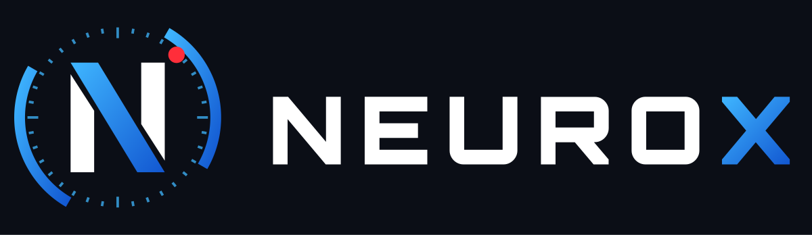

<p align="center">
  
</p>

<h3 align="center">Drive with a blink and a clench.</h3>

<p align="center">
  A hands-free controller that turns eye blinks and jaw clenches into movement.<br>
  It drives an RC car today. A slow, motorised wheelchair is next.
</p>

---

## Contents

1. [What NeuroX is](#1-what-neurox-is)
2. [How it works](#2-how-it-works)
3. [Gestures](#3-gestures)
4. [Safety lock (3-second unlock)](#4-safety-lock-3-second-unlock)
5. [Hardware](#5-hardware)
6. [Electrode placement](#6-electrode-placement)
7. [Wiring and pin map](#7-wiring-and-pin-map)
8. [Firmware](#8-firmware)
9. [First run: calibration and personal training](#9-first-run-calibration-and-personal-training)
10. [Serial hotkeys](#10-serial-hotkeys)
11. [Radio protocol and the receiver](#11-radio-protocol-and-the-receiver)
12. [Testing on virtual people](#12-testing-on-virtual-people)
13. [3D-printed parts](#13-3d-printed-parts)
14. [Brand: logo, colours, fonts](#14-brand-logo-colours-fonts)
15. [Repository layout](#15-repository-layout)
16. [Troubleshooting](#16-troubleshooting)
17. [Roadmap](#17-roadmap)
18. [Safety notice](#18-safety-notice)
19. [Credits and license](#19-credits-and-license)

---

## 1. What NeuroX is

NeuroX is a biosignal controller for people who can't easily use their hands. It reads two signals from the face:

- **EOG**: the electrical signal from the eyes. A blink makes a clear spike.
- **EMG**: muscle activity. Clenching the jaw makes a burst of muscle signal at the temples.

An ESP32-S3 decides which gesture you made and sends a drive command over ESP-NOW radio to the vehicle.

| Part | What it is |
|---|---|
| **NeuroX box** | ESP32-S3, 2 × BioAmp EXG Pill, battery, 2.8" screen, 3 buttons + red STOP. Sits on the armrest. |
| **NeuroX HALO headset** | A passive 3D-printed headset that holds the 6 snap electrodes in place, so you don't have to stick them on one by one. It has no electronics. |
| **Receiver** | ESP32 Dev Module + L298N on the RC car. A wheelchair drive box is planned. |
| **Armrest holder** | Magnetic snap-in dock + locking arm + adjustable tube clamp. Concept stage. |

**Status**

| Item | State |
|---|---|
| Gesture engine v13.2 + LR steering (4 gestures) | ✅ Used on the RC car |
| PRO filters (talking, look-down, everyday blinks) | ✅ Simulated: 80/80 driving gestures; ⏳ real-world test pending |
| 3-second safety lock (Pro-Safe) | ✅ Simulated on 50 virtual people; ⏳ real-world test pending |
| **NeuroX Final**: auto-calibration at power-on + 3 s lock + anti-yawn + buttons | ✅ Simulated on 200 virtual people of every kind (93 % gestures, 0 false unlocks on unseen people); ⏳ real-world test pending |
| Box v3 "Reticle" print files (STEP / STL / 3MF) | ✅ Ready, not printed yet |
| HALO headset print files (AMS) | ✅ Ready, not printed yet |
| Armrest holder | 🎨 Concept renders |
| Screen UI on the box (boot screen, live status) | ⏳ Boot image ready (`neurox_boot.h`), UI code not written yet |
| Wheelchair receiver (soft start, speed cap, signal-loss stop) | ⏳ Waiting for the motor + driver choice |

---

## 2. How it works

```
 electrodes (6 snaps in the HALO headset)
        │
        ▼
 2 × BioAmp EXG Pill ──► ESP32-S3 in the NeuroX box (256 samples/s per channel)
   GPIO 1: forehead / nose        │  DSP: 50 Hz notch, despike, band filters, EMG envelope
   GPIO 4: temples                │  gesture engine v13.2 → blink / clench
                                  │  steering: single / double gesture → F R < >
                                  │  PRO filters: talking, chewing, looking down, everyday blinks
                                  │  safety lock: locked until a 3 s eye squeeze
                                  ▼
                       ESP-NOW broadcast, channel 1
                       packet {'N','X', cmd, seq}, heartbeat every 80 ms
                                  │
                                  ▼
        receiver ESP32 ──► L298N ──► motors   (failsafe: no packet for 500 ms = STOP)
```

**Signal chain:** for each channel, on every 256 Hz tick:

1. The ADC sample (12-bit, 4 conversions averaged) has its DC offset removed.
2. The EMG path removes pops, applies a 50 Hz notch and a 15 Hz high-pass, rectifies the signal and takes a 32-sample moving average.
3. The EOG path applies a 50 Hz notch, then a 5-sample median to remove spikes, then a 0.5–12 Hz band-pass.
4. A slow 2 Hz level signal is kept as well. It is only used to detect a held bite.

**Gesture state machine:** `ARMED → CAPTURE (≈195 ms window) → SETTLE → ARMED`

- **ARMED.** A capture opens only on a sharp edge, never on slow drift or filter tails.
- **CAPTURE.** The firmware decides only after the whole window has been seen.
- **SETTLE.** The firmware waits at least 220 ms and for a quiet signal. After a bite, it also waits until the bite is released, plus 640 ms.

---

## 3. Gestures

| You do | Command | Car / wheelchair | Sent |
|---|---|---|---|
| **Clench** your jaw once (bite ~0.5–1 s, relax) | `F` | Forward pulse (420 ms) | ~1.5 s later (it waits to see if a 2nd clench follows) |
| **Blink** firmly once | `R` | Reverse pulse (420 ms) | ~1 s later (it waits to see if a 2nd blink follows) |
| **Double blink** (2nd blink 0.25–1 s after the 1st) | `<` | Spin left on the spot (300 ms, adjustable) | Immediately after the 2nd blink |
| **Double clench** (bite, relax, bite within ~1.5 s) | `>` | Spin right on the spot | 0.9 s after the 2nd bite (to make sure no 3rd bite follows) |

Every command is a **short pulse followed by a cooldown**, so nothing keeps moving unless you keep asking.

**PRO filters**: these stop everyday life from turning into commands:

- **Talking / chewing.** A clench only counts if the jaw was quiet before it. Extra jaw bursts in the last few seconds, a 3rd bite after a double clench, or one burst longer than 1.7 s are treated as talking and ignored.
- **Looking down/up at the car.** The eye-level shift this causes is not read as a blink.
- **Everyday blinks.** After personal training, a blink smaller than 65 % of your trained blink is ignored (`FIRM_BLINK_ENABLED`).
- **Missed double clench.** If the 2nd-bite watcher missed it, the double clench becomes TURN RIGHT instead of FORWARD.

---

## 4. Safety lock (3-second unlock)

Firmware **NeuroX_Final_Sender** (same lock as Pro-Safe, plus the anti-yawn check):

| State | What happens |
|---|---|
| **LOCKED** (at power-on) | Gestures are ignored. The vehicle only receives STOP. |
| **Unlock** | Close your eyes **firmly** and hold for **3 s**. The serial monitor counts the hold, and the buzzer ticks if one is connected. |
| **UNLOCKING** | Relax and open your eyes. A 1 s grace period follows, so opening your eyes isn't read as a blink. |
| **ACTIVE** | After the READY beep, drive with the four gestures. |
| **Relock** | 3 s without a command → LOCKED again. |

- Eating, talking and coughing come in short bursts, so they can't hold the signal for 3 s.
- **Anti-yawn** (Final): the 3 s must also average ≥ 35 % of your calibration squeeze. In the 100-person test this removed almost all false unlocks; yawns were the main cause.
- If calibration finds your eye squeeze too weak to see (e.g. facial palsy), you unlock by **biting and holding 3 s** instead.
- The calibration's squeeze step measures **your** squeeze, and the unlock level is set from it. It is never above 60 % of your squeeze, so it always stays reachable.
- If your squeeze looks like your clench, a forehead/temple ratio check is added, so a clench can't unlock.
- Keyboard: `o` locks or unlocks. The test pulses `f` `b` `l` `r` work in every state (for the operator).
- Buzzer (optional): **+ to GPIO 13, − to GND**.

---

## 5. Hardware

### NeuroX box (sender)

| Qty | Part |
|---|---|
| 1 | ESP32-S3 DevKitC-1 |
| 2 | Upside Down Labs **BioAmp EXG Pill** |
| 6 | Snap electrode leads + gel ECG pads |
| 1 | 2.8" SPI TFT 240×320, ILI9341 (resistive touch) |
| 4 | 12×12×7.3 mm tactile switches for the printed buttons (3 + STOP) |
| 1 | KCD1 rocker switch, 2 pins |
| 1 | TP4056 USB-C charger module |
| 1 | MT3608 boost module, **set to 5.1 V before connecting anything** |
| 1 | LiPo 103450 (~2000 mAh) **with protection board** |
| 1 | Passive or active buzzer (GPIO 13) |
| — | Perfboard 68×50 mm, female headers, 3 × 100 kΩ + 1 × 150 kΩ, 100 nF, 100 µF |
| — | Screws: 4 × M3×12 countersunk (lid), 8 × M2×6 (perfboard, screen clamp tabs), 8 × M2×10 (buttons). Full list for box + HALO: [`docs/NeuroX_Screw_List.xlsx`](docs/NeuroX_Screw_List.xlsx) |
| — | 8 mm braided sleeve for the 2 pill cables; 4 steel discs 10 mm (for the magnetic dock) |

### Receiver (RC car)

ESP32 Dev Module, L298N motor driver, 2 TT motors, battery. ENA/ENB are jumpered HIGH.

### Planned: wheelchair drive

2 × 24 V worm-gear motors and a dual motor driver (e.g. BTS7960 pair or Cytron). Worm gears hold the chair still on slopes. There is also a carer e-stop on the push handle.

---

## 6. Electrode placement

| Pill | Electrodes | Signal |
|---|---|---|
| **GPIO 1** | **forehead centre** + **just above the nose bridge** | Blinks (EOG) and forehead/jaw EMG; drives all gesture decisions |
| **GPIO 4** | **left + right temple, at eye level** | Jaw-clench EMG (temporalis muscle) |
| REF | on the **bone behind each ear** | Reference for each pill |

With the HALO headset, the 6 leads clip into channels in the band, and the gel pads snap onto the pods. To put it on, slide it on and turn the dial at the back to tighten.

---

## 7. Wiring and pin map

**ESP32-S3 DevKitC-1 (NeuroX box)**

| GPIO | Connected to |
|---|---|
| 1 | Pill (forehead / nose) OUT |
| 4 | Pill (temples) OUT |
| 13 | Buzzer + |
| 2 | Battery sense (boost IN+ → 100 k → GPIO 2 → 100 k → GND, 100 nF to GND) |
| 21 | Charger plugged in (TP4056 IN+ → 100 k → GPIO 21 → 150 k → GND) |
| 12 / 11 / 10 / 9 / 8 / 18 / 14 | Screen SCK / MOSI / MISO / CS / DC / RESET / LED |
| 17 / 16 | Touch T_CS / T_IRQ (T_CLK, T_DIN, T_DO shared with the screen) |
| 15 / 7 / 6 / 5 | Buttons STOP / NEW / LEFT / RIGHT-OK (other leg to GND) |

**Power**

```
LiPo + → TP4056 B+          LiPo − → TP4056 B−
TP4056 OUT+ → rocker → boost IN+       TP4056 OUT− → boost IN−
boost OUT+ (5.1 V) → ESP32 5V          boost OUT− → GND   (100 µF across the output)
```

Switch OFF with USB-C plugged in means charging. Keep the two pill OUT wires short and away from the screen wires.

**Receiver (L298N)**: left motor IN1 = GPIO 19, IN2 = GPIO 18; right motor IN3 = GPIO 5, IN4 = GPIO 21. L298N GND must be connected to ESP32 GND.

> ⚠️ **Never charge or use USB while the electrodes are on someone.** Run on battery only while the electrodes are worn. Plug in USB (programming or charging) only with the electrodes off.

---

## 8. Firmware

| Folder | Board | What it is |
|---|---|---|
| **`NeuroX_Final_Sender/`** ⭐ | ESP32-S3 | **Recommended.** Auto-calibration at power-on (no keyboard), 3 s lock with anti-yawn, noise tracking, STOP / NEW buttons, all PRO filters. Tested on 200 virtual people. `v13.2-ESPNOW-r3-LR2-FINAL` |
| **`RC_Car_LR_Receiver/`** | ESP32 Dev Module | Car receiver for all LR senders (F R < > S) |
| `tools/NeuroX_Display_Test/` | Arduino Uno | Test sketch for the 2.8" ILI9341 screen + touch (wiring in the sketch) |

**Flashing (Arduino IDE)**

1. Install **esp32 by Espressif** (core **2.0.17** or **3.x**). Both compile with no warnings.
2. Sender: board **ESP32S3 Dev Module**, *USB CDC On Boot: Enabled* (if you use the native USB port).
3. Receiver: board **ESP32 Dev Module**.
4. Each `.ino` must be in a folder with the same name.
5. Serial monitor: **115200 baud**.

---

## 9. First run: calibration and personal training

**NeuroX Final calibrates by itself at every power-on.** No keyboard is needed, and the car does not move during it. Sit still and follow the beeps (~40 s):

1. `[READY]` + 2 beeps → **sit still**, eyes open, jaw relaxed. The firmware measures your resting noise.
2. One beep + `BLINK now` → **blink firmly once** (5×).
3. One beep + `CLENCH now` → **bite ~1 s, then relax** (5×).
4. One beep + `CLOSE your eyes firmly and hold` → hold until the 2 short beeps + `relax, eyes open` (2×).
5. Melody + `[AUTO] done. LOCKED` → close your eyes firmly 3 s to unlock.

Only what you do right after a beep is recorded, so everyday blinks in between don't spoil it.

- **Unclear result:** it asks once more. If it is still unclear, it keeps your last good calibration (or the factory settings).
- **Calibrate again any time:** **NEW** button (GPIO 7), hold **BOOT** 1 s, or key `t` / `a`.

From your samples it sets:

- the blink thresholds (60 % of your blink; slow blinkers are recognised)
- the jaw EMG source, level and duration
- your bite length, which sets the double-clench window and the talking filter
- the unlock level, the anti-yawn level and the forehead/temple ratio
- your resting noise (followed afterwards on a calm signal)

Older senders (Pro-Safe): press **`t`** for the keyboard-paced training; **`u`** returns to factory thresholds.

---

## 10. Serial hotkeys

| Key | Action |
|---|---|
| `1` `2` `3` | Sensitivity preset ×0.85 / ×1.00 / ×1.35 |
| `+` `−` `0` | All thresholds ±10 % / reset ×1.00 |
| `j` `k` | Jaw clench (FORWARD) 10 % more / less sensitive |
| `f` `b` `l` `r` | Test pulse forward / reverse / left / right |
| `[` `]` | Turn time −/+ 50 ms (100–1000 ms, default 300) |
| `s` | STOP + clear + re-arm |
| `c` | Recalibrate (sit still 2 s) |
| `t` / `a` | Calibrate again (Final: follow the beeps) |
| `y` | Old keyboard-paced training (Final) |
| `u` | Factory thresholds |
| `o` | Lock / unlock (Pro-Safe) |
| `z` | Buzzer test |
| `p` | Plotter CSV ↔ debug text |
| `h` | Help |

---

## 11. Radio protocol and the receiver

- **ESP-NOW broadcast** to `FF:FF:FF:FF:FF:FF`, Wi-Fi channel 1.
- **Packet:** `{ 'N', 'X', cmd, seq }`, where `cmd` is `F` forward, `R` reverse, `<` left, `>` right, `S` stop, and `seq` is a rolling counter (gaps = lost packets).
- **Sending pattern:**
  - Every new command is sent 3× on consecutive ticks, then repeated every 25 ms for 250 ms.
  - The current command is re-sent every **80 ms** as a heartbeat.
  - Packets go out only right after an ADC sample, so the Wi-Fi current burst never overlaps a measurement.
- **Receiver safety:**
  - **Failsafe:** no valid packet for **500 ms** → STOP.
  - **Reversal brake:** 150 ms of braking before any change of direction.
  - **Brownout:** brownout resets are reported at boot.

---

## 12. Testing on virtual people

The real firmware source is compiled for the PC and fed simulated electrode signals at 256 Hz. Each virtual person is built from the creator's own signal profile, with every property (blink size and shape, clench strength, bite length, eye squeeze, noise, talking, chewing) varied by ±20 %.

**Pro-Safe results** (50 people, untrained / trained):

| Test | Untrained | Trained |
|---|---|---|
| Unlock with a 3 s eye squeeze | 153/153 | 152/152 |
| Time from closing the eyes to UNLOCKED | 3.06–3.10 s | 3.08–3.15 s |
| Driving gestures correct (18 per person) | 895/900 (99.4 %) | 894/900 (99.3 %) |
| 4 min of everyday life while LOCKED: false unlocks / moves | 0 / 0 | 0 / 0 |
| The same 4 min on LR2-PRO (no lock): moves | 1395 | 1526 |
| Driving while also blinking normally | 779/900 | 780/900 |

The test found one bug, now fixed: the 3 s squeeze looks like one long jaw burst, so the talking filter was blocking the first clench after every unlock.

**Known weak spot (Pro-Safe):** an everyday blink within 1 s of a command blink is read as a double blink (TURN LEFT). Blink firmly for commands.

### NeuroX Final: 200 virtual people of every kind

**The groups:**

- typical
- weak blink / ptosis / myasthenia
- facial palsy
- weak jaw / TMJ
- tremor / Parkinson's
- spasms / cerebral palsy
- frequent involuntary blinks
- slow / elderly / fatigue
- noisy electrodes
- nystagmus
- very strong signals

The firmware was tuned on people 1–100 and then checked on people 101–200, whom it had never seen. Every person calibrates by following the beeps, drives 18 gestures while blinking naturally, then lives 4 minutes while LOCKED: talking, chewing, yawning, frowning, looking around, head movement.

| | Pro-Safe, keyboard-trained | **Final, 1–100** | **Final, 101–200** |
|---|---|---|---|
| Driving gestures correct | 77 % | **93 %** | **93 %** |
| Failed unlocks | 149 / 586 | **0 / 330** | **0 / 346** |
| False unlocks in 400 min of everyday life | 52 | **1** | **0** |
| Car moves while locked | 84 | **1** | **0** |
| People like you: clean / with natural blinks | 99.4 % / 86.6 % | **99.3 % / 96.6 %** | |

The full per-group results, and the 17 problems the test found and fixed, are in `docs/TEST_REPORT.md`.

---

## 13. 3D-printed parts

All parts are designed for the **Bambu Lab A1 mini + AMS lite** (180 × 180 bed) in four colours: **midnight gray, white, blue, red**. They print in PLA with no supports.

### Box v3 "Reticle"  →  [`hardware/NeuroX_Box_v3/`](hardware/NeuroX_Box_v3/)

163 × 101 × 50 mm, sci-fi shell: faceted midnight body with a blue base line, white lid with the Reticle N logo inlaid in 4 colours, blue HUD brackets around the screen, red STOP guard, NEUROX lettering on the front, blue grommet for the electrode sleeve.

- **Screen pocket** fitted to the tested 82 × 50 mm ILI9341 board (window shows only the picture), 4 clamp tabs with M2 screws.
- **Printed buttons** for 12×12 tactile switches: guide + cap + cradle per button, STOP with a red mushroom top. Guide: `4_renders/NeuroX_Box_v3_buttons_guide.png`.
- `extras/display_fitcheck/`: just the screen part of the lid, to test the screen fit fast.

| Folder | Use |
|---|---|
| `1_Bambu_Studio_3MF/` | 6 plates with colours (plate 1 = fit check + small parts, **print first**; plates 4-6 = buttons, STOP, grommet) |
| `2_STEP_Fusion360/` | Real CAD solids (assembly + each part) |
| `3_STL/` | Per colour (multicolour), one-colour and button parts |
| `5_source/` | CadQuery scripts that generate everything (`box_v3_cq.py`, `box_buttons_cq.py`) |

Print settings: 0.20 mm layers, 3 walls, 15–20 % infill, textured PEI plate. The lid prints **top face down**.

### HALO v3 headset  →  [`hardware/NeuroX_HALO_v3/`](hardware/NeuroX_HALO_v3/)

A passive head frame: front band, 2 sides, rear strap with a dial, 5 ribs and a crown hub, a NEUROX crest. Snap-electrode cups sit at the forehead, nose bridge, both temples and behind both ears.

- **Extendable stems with a screw lock:** temple, REF and nose pods sit on grooved sliders. Loosen the blue knob, slide in 2 mm steps, tighten: locked.
- **8 AMS plates**, fit check first. Plates 3 (sides) and 4 (strap) need supports (see the README there).
- **Assembly guide:** `4_renders/NeuroX_HALO_v3_assembly_1_frame.png` and `_2_finish.png`.
- The full assembly STEP is zipped (`2_STEP_Fusion360/NeuroX_HALO_v3_assembly.step.zip`) to stay small; every part is also there as its own STEP.

Hardware: M3 screws, 6 × M3×8 socket head + nuts for the lock knobs, 1 M4×16 hex bolt + nut for the dial, EVA foam and your usual gel pads. Full list: [`docs/NeuroX_Screw_List.xlsx`](docs/NeuroX_Screw_List.xlsx).

### Armrest holder  →  concept

- **Dock:** 4 × 10×3 mm magnets pull the box down into place. 18 mm walls on the front, back and corners stop it sliding off. The sides stay open for the ports.
- **Arm:** two toothed joints (24 teeth, 15° steps) for swivel and tilt. They lock and cannot slip.
- **Clamp:** V-jaws lined with rubber grip any 16–38 mm tube, round or square. They close with 2 steel M6 bolts and star knobs: tighten once and leave it.
- **Material:** print it in **PETG** (PLA slowly creeps under constant clamp force).
- **Status:** not released yet. It waits for the real armrest tube measurement.

---

## 14. Brand: logo, colours, fonts

**Reticle N**: a stencil N inside a HUD targeting ring.

- The glowing diagonal is your signal cutting through the N.
- The broken ring is the headset band, seen as a scanner.
- The red dot is the "live" light.

| Token | Hex | Use |
|---|---|---|
| Void | `#0B0E16` | Background |
| Midnight | `#1E222D` | Body / filament |
| Neon | `#3FB6FF → #1257D1` | Gradient, glow |
| White | `#FFFFFF` | Text / filament |
| Live red | `#FF2E3A` | Live dot and STOP only |

- **Wordmark:** Orbitron Black, +14 % letter spacing, the X in the neon gradient.
- **UI text:** Rajdhani SemiBold, uppercase, wide tracking.

The logo pack (`logo/`) has:

- SVG files, with all text outlined
- neon PNGs with the glow baked in
- flat and one-colour versions
- an app icon and a favicon
- the 320×240 TFT boot screen, as a PNG and as an RGB565 header (`neurox_boot.h`)

---

## 15. Repository layout

```
NeuroX/
├── README.md
├── firmware/
│   ├── NeuroX_Final_Sender/          ⭐ sender (auto-calibration, lock, STOP / NEW)
│   └── RC_Car_LR_Receiver/           RC car receiver
├── hardware/
│   ├── NeuroX_Box_v3/                box + printed buttons: 3MF · STEP · STL · renders · source
│   │   └── extras/display_fitcheck/  screen-only fit check
│   └── NeuroX_HALO_v3/               headset: 3MF · STEP · STL · renders · source
├── logo/                             svg · png · screen (boot image + neurox_boot.h)
├── docs/
│   ├── QUICK_START.md
│   ├── TEST_REPORT.md                200 virtual people (Final)
│   ├── VIRTUAL_YOU_TEST.md           170 sessions on a model of you
│   ├── NeuroX_Screw_List.xlsx        every screw + nut for box and HALO
│   └── images/                       system concept sheets
├── sim/                              PC harness that runs the real firmware on virtual people
└── tools/
    └── NeuroX_Display_Test/          Arduino Uno test for the screen + touch
```

---

## 16. Troubleshooting

| Problem | Try |
|---|---|
| Calibration says `unclear` | Re-gel the pads, sit still, press **NEW** |
| Blinks trigger FORWARD | Calibrate again (**NEW** / `t`); or press `k` (jaw less sensitive) |
| Clenches not detected | Bite ~0.5–1 s and relax fully; press `j`; check the temple electrodes' gel |
| Talking moves the car | That's what the PRO filter is for. Make sure you're on a PRO sender; train with `t` |
| Car turns left when you wanted reverse | Avoid a natural blink right after a command blink; train for firm-blink detection |
| Won't unlock | Close your eyes firmly for the whole 3 s (watch `[LOCK] holding…`). `too gently` means squeeze like in calibration. Or calibrate again, or press `o` |
| Locks while driving | 3 s without a command locks it. Give the next command sooner, or unlock again |
| Car stops on its own | Receiver failsafe (500 ms without packets): check sender power and range, same channel 1 |
| `BROWNOUT` on the car | Motor battery too weak. Charge it, or use a separate supply for the ESP32 |
| `CLIPPED` / noisy signal | Re-gel the electrodes, keep the pill wires short, move away from chargers and mains |

---

## 17. Roadmap

- [ ] Real-world test of the 3 s lock with the electrodes on
- [ ] Screen UI: boot screen, live signal bars, lock state, last command, battery
- [x] STOP and NEW buttons in firmware (Final); ◀ ▶ still for the screen UI
- [x] Print the box v3 and HALO fit checks, then adjust the files (screen pocket, stem lock, cup front)
- [ ] Armrest holder: measure the tube, then print files
- [ ] Wheelchair receiver: soft start/stop, speed cap, signal-loss stop, carer e-stop
- [x] Reduce "natural blink after command blink" errors (Final: blink-pair size check)
- [x] Calibrate without a keyboard (Final: auto-calibration at power-on)

---

## 18. Safety notice

NeuroX is a student / maker research project. **It is not a medical device** and it is not certified for driving a real wheelchair.

- Test only on the RC car or with the wheels off the ground, until a carer-operated **hardware e-stop** and the receiver's **failsafe** are fitted and tested.
- Keep speeds low.
- Never use USB power or charge the box while the electrodes are worn. Run it on battery only.
- Use fresh gel electrodes on clean skin, and stop if the skin is irritated.

---

## 19. Credits and license

- Biosignal front-end: **BioAmp EXG Pill** by Upside Down Labs.
- Fonts: Orbitron and Rajdhani (SIL Open Font License).
- Tools: Arduino-ESP32, OpenSCAD, CadQuery, Bambu Studio.

**License:** _add one before publishing (e.g. MIT for code, CC BY-SA for hardware)._

**Author:** Gurnihaal Singh · Built with ❤️ for hands-free mobility.
