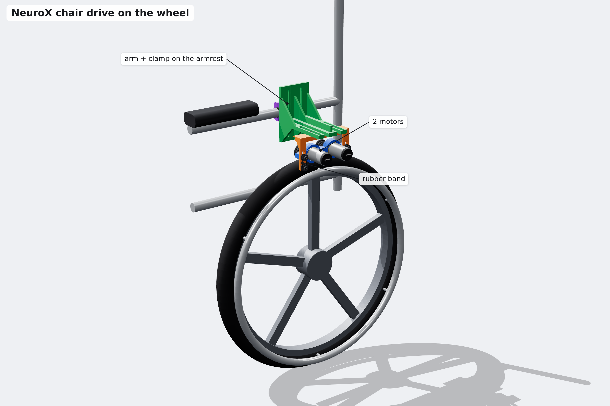
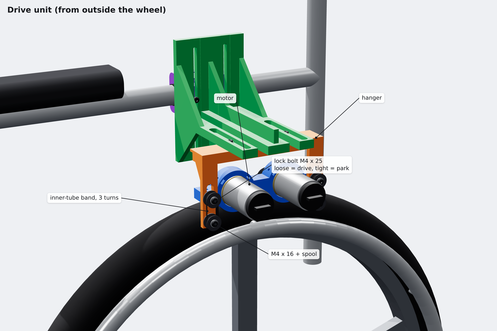
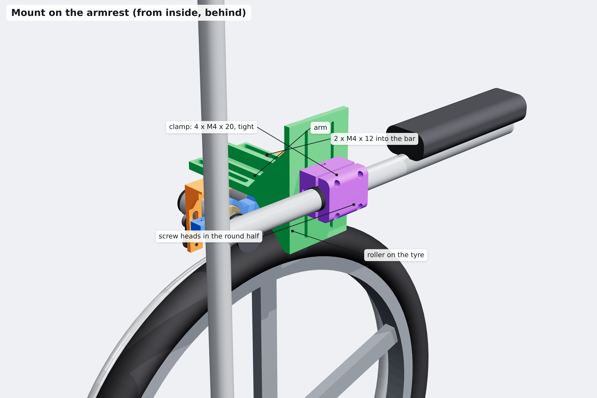
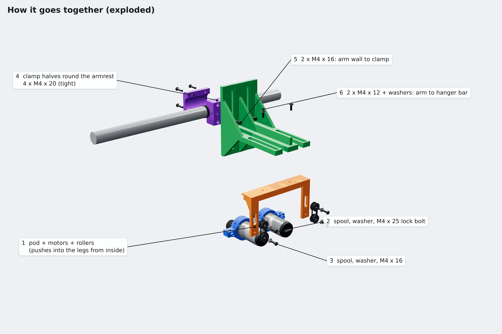
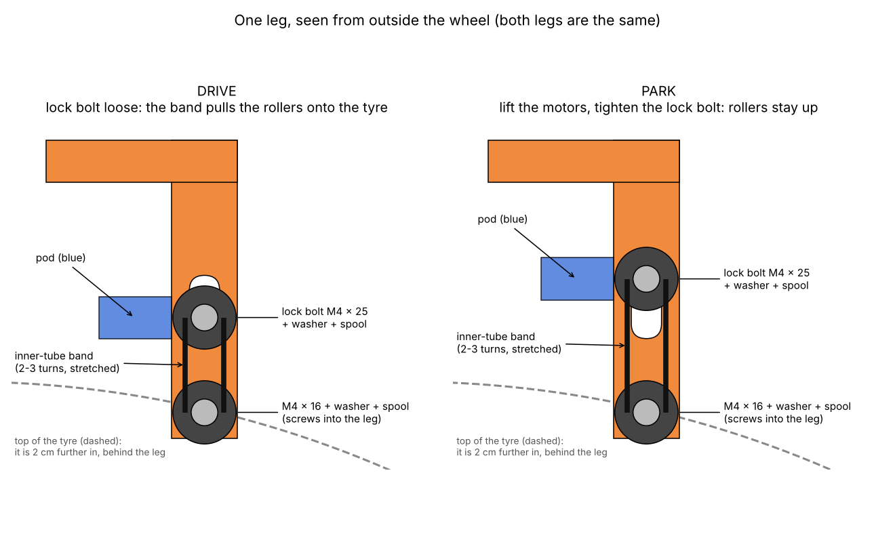
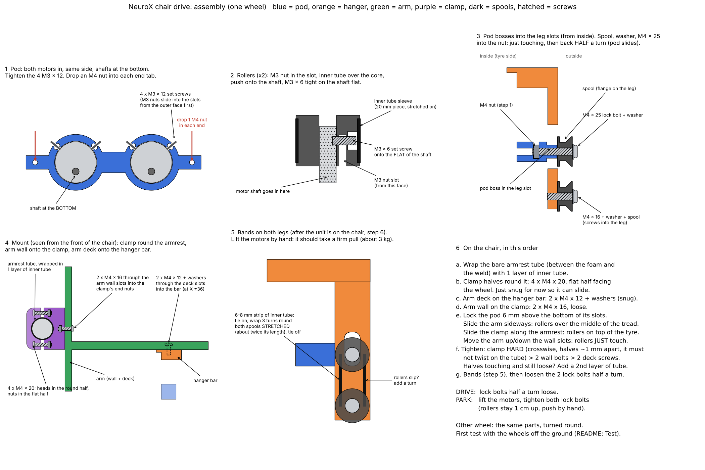
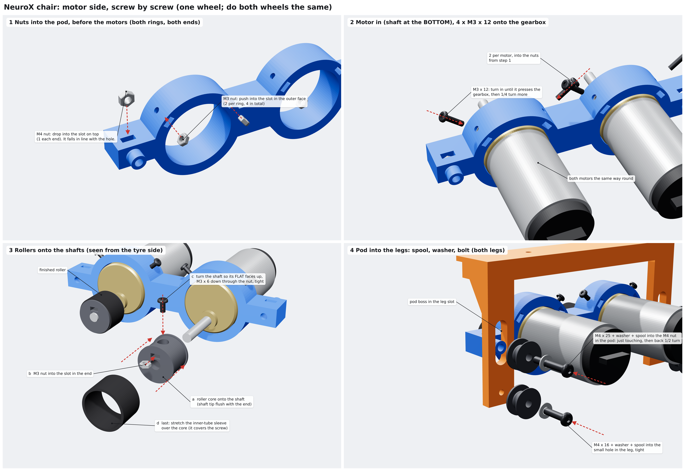
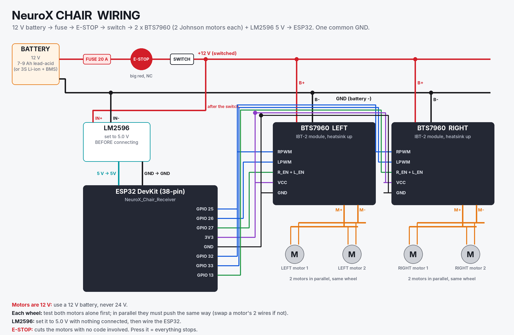

# NeuroX Chair: top friction drive for a manual wheelchair

Two Johnson 12 V 500 RPM geared motors sit on top of each rear tyre. Their rubber rollers press on the tread and drive the wheel. **No springs:** loops of bicycle inner tube pull the motor pod down. Lift the pod and tighten two lock bolts, and the rollers stay off the tyre so the chair can be pushed by hand again.
Made for the **Vissco Rodeo Veer** (24" mag wheels). The whole unit clamps onto the **bare part of the armrest tube** (25 mm, the 14 cm between the grey foam and the weld at the backrest): rubber-lined, 4 bolts, no drilling.
Every screw is from an **M3 + M4 button-head kit** (M4: 8–25 mm, hex nuts, washers).

## Numbers
| | |
|---|---|
| Roller | 21 mm printed core + bicycle inner tube, about 24 mm |
| Speed | about **2.3 km/h** at full 12 V (slow walk); firmware caps it at 60 % to start |
| Push | about 31 N at rated torque from 4 motors; about 19 N is needed on flat ground (95 kg). **Flat floors only, no ramps.** |
| Current | about 1.5–2 A per motor running, up to about 8 A per motor stalled; 20 A fuse |

## Print
1. `NeuroX_Chair_tube_sizer.3mf` first (20 min): hold it against the armrest tube; the smallest hole that slides on is your size. Notches above the hole: 1 = 19, 2 = 20, 3 = 22, **4 = 25**, 5 = 28, 6 = 30, 7 = 32 mm.
2. Per wheel, print each twice:
   - `NeuroX_Chair_drive_ONE_WHEEL.3mf`: motor pod + hanger (bar with 2 legs) + 2 roller cores + 4 band spools
   - `NeuroX_Chair_mount_ONE_WHEEL_25mm_armrest.3mf` (or `_22mm_` / `_28mm_`): arm + 2 clamp halves
   - Before the pods: `NeuroX_Chair_MOTOR_fitcheck.3mf` (15 min): ring over the gearbox, roller on the shaft
3. Optional: `NeuroX_Chair_rollers_TPU_x4.3mf` = solid 24 mm TPU rollers instead of cores + inner tube.

PETG if you have it, PLA works. 5 walls, 40 % gyroid, 0.2 mm, no supports; every part is already flat on the plate.

## Hardware (per wheel)
- 2 x Johnson 12 V 500 RPM side-shaft geared motor
- **M3 kit:** 4 x M3 x 12 + 4 nuts (gearbox set screws), 2 x M3 x 6 or x 8 + 2 nuts (roller set screws)
- **M4 kit** (button head Allen):

| Where | Screws | Nuts | Washers |
|---|---|---|---|
| Clamp on the armrest | 4 x M4 x 20 | 4 | - |
| Arm to clamp | 2 x M4 x 16 | 2 (captive in the clamp) | - |
| Arm deck to hanger bar | 2 x M4 x 12 (cut their own thread in the bar) | - | 2 |
| Lock bolts (top spools) | 2 x M4 x 25 | 2 (in the pod) | 2 |
| Leg spools | 2 x M4 x 16 (cut their own thread in the leg) | - | 2 |

  **Both wheels:** M4 x 25: 4, M4 x 20: 8, M4 x 16: 8, M4 x 12: 4, nuts: 16, washers: 12. Your kit (10 of each length, 20 nuts, 20 washers) covers it, with 4 nuts and 8 washers spare.
- Bicycle inner tube: 2 roller sleeves (20 mm long), 1 clamp liner (60 x 80 mm), **2 band strips 6–8 mm wide x about 40 cm long**
- Optional: 1 small hose clip under the clamp as a stop collar

### Why bands and not springs
There are no springs in the kit, and its longest screw is 25 mm, so the old spring bolts (M5 x 70) are gone. Inner-tube rubber makes a good spring: 3 stretched turns (6 strands) of a 6 mm strip pull roughly 30–50 N per side, more than the rollers need to grip (about 10 N each). More turns = more grip. It costs nothing, and you already need the tube for the rollers.
If you buy springs later: any pulling (extension) spring about 30 mm long hooks onto the same two spools.

## Build

1. **Rollers:** push the roller core on the shaft (shaft tip flush with the end), M3 nut into the slot in the end, turn the shaft so its **flat** faces the screw hole, M3 x 6 down through the nut, tight. Last, stretch a 20 mm piece of inner tube over the core.
2. **Pod:** slide 4 M3 nuts into the slots, push both gearboxes into the rings with the **shaft at the bottom**, both motors on the same side. Tighten the 4 M3 x 12 set screws. Drop one **M4 nut** into the slot on top of each end tab of the pod (it falls into place in line with the boss hole).
3. **Pod into the hanger:** put the pod's two round bosses into the slots of the two hanger legs (from the inside). On each boss: spool (flat flange against the leg), washer, **M4 x 25 lock bolt** into the nut. Turn it until it just touches, then back half a turn: the pod must slide up and down freely.
4. **Leg spools:** spool + washer + **M4 x 16** into the small hole at the bottom of each leg, tight (it cuts its own thread).
5. **Clamp nuts:** drop 4 M4 nuts into the hex pockets of the outer clamp half (from the flat face). Slide 2 M4 nuts into the two slots in the **ends** of the outer half (the pair that ends up side by side along the armrest).
6. **Arm on the hanger:** 2 x M4 x 12 + washers down through the deck slots into the bar holes at X = ±36. They cut their own thread; snug, so the arm can still slide.
7. **On the chair:** wrap the bare armrest tube (between the foam and the weld) with one layer of inner tube. Put the two clamp halves round it with 4 x M4 x 20, flat face of the outer half facing the wheel. Just snug for now, so it can still slide.
8. **Arm to clamp:** 2 x M4 x 16 through the two tall slots in the arm's wall into the clamp's end nuts. The heads sit in the channels in the deck; an Allen key reaches them from the wheel side. Leave them loose.
9. **Line it up (no bands yet):** lock the pod with its bosses **6 mm above the bottom** of the slots (lock bolts tight). Slide the arm on the deck slots until the rollers are over the **middle of the tread**, slide the clamp along the armrest until the rollers are over the top of the tyre, and move the arm up/down the wall slots until the rollers **just touch** the tyre. Tighten: clamp bolts **hard**, a little at a time, crosswise, until the halves are about 1 mm apart and the clamp can't be twisted on the tube by hand; then the 2 wall bolts, then the 2 deck screws. The clamp halves have a 4 mm gap, so they can squeeze a lot. If they touch and the clamp still turns, add a second layer of inner tube.
10. **Bands:** on each leg, tie one end of a strip round the lower spool, wrap it **3 turns** round both spools, pulling it to about twice its length, and tie it off. Loosen the lock bolts half a turn.
11. **Test the grip:** lift the motors with one hand. It should take a firm pull (about 3 kg). Rollers slip under load = add a turn.

### Drive / park
- **Drive:** both lock bolts half a turn loose. The bands pull the rollers onto the tyre.
- **Park (push by hand):** lift the motors up (the bosses go to the top of the slots) and tighten both lock bolts. The rollers stay about 1 cm off the tyre.
- Before each ride: lock bolts loose, bands not cracked (replace them when they look dry or split).

### Fit (checked in CAD, `chair_mount_check.py`: 9 tube positions, driving and lifted)
- Armrest tube centre **80–160 mm inboard** of the tyre centre (deck slots) and **29–159 mm above the top of the tyre** (wall slots).
- Front/back: the clamp slides along the 14 cm of bare tube; the rollers work anywhere within ±30 mm of the top of the tyre.
- Nothing touches the tyre (45 mm wide), push rim, motors, spools or bands: driving, dropped 5 mm and parked (`chair_check.py`).
- Every screw length is checked against the kit (both check scripts).
- The deck crosses over the black side guard about **7 cm above the top of the tyre**: check the guard's top edge is lower than that.

## Wiring

## Firmware: `firmware/NeuroX_Chair_Receiver`
Settings at the top: `MAX_DUTY_PCT` (start 60), `REV_DUTY_PCT`, ramps, `INVERT_LEFT/RIGHT`, `LEFT/RIGHT_TRIM_PCT`.
PC test: `firmware/NeuroX_Chair_Receiver/host_test/run.sh` (22 checks: no start before STOP, link-loss stop, ramps, reverse through zero, no shoot-through, bench test).

## Test, in this order
1. **Wheels off the ground** (chair on blocks), box OFF: Serial 115200, type `t`. Each step must turn the named wheel the right way. Wrong way: flip `INVERT_LEFT` / `INVERT_RIGHT`. One motor of a pair fights the other: swap that motor's two wires.
2. Wheels off the ground, box ON: lock, unlock, clench (forward), blink (reverse), STOP, switch the box off (chair must stop within 0.3 s).
3. **E-STOP** while a wheel is running: everything stops.
4. Empty chair on flat floor, someone walking beside it holding the push handles.
5. A helper sits in it, feet ready to touch the floor, a second person beside with the E-STOP.
6. Only then the real rider. Flat, smooth floor, an adult nearby. Never near stairs, kerbs or roads.

This is a homemade, uncertified device. Friction drive has no parking brake: keep the chair's own wheel locks on when stopped.
