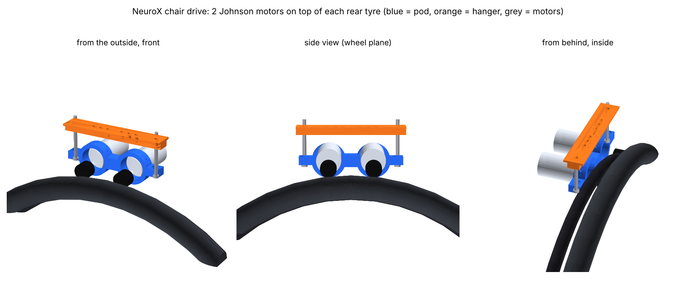

# NeuroX Chair: top friction drive for a manual wheelchair

Two Johnson 12 V 500 RPM geared motors sit on top of each rear tyre. Their rubber rollers press on the tread and drive the wheel. Tighten two nuts and the rollers lift off, so the chair can be pushed by hand again.

## Numbers
| | |
|---|---|
| Roller | 21 mm printed core + bicycle inner tube, about 24 mm |
| Speed | about **2.3 km/h** at full 12 V (slow walk); firmware caps it at 60 % to start |
| Push | about 31 N at rated torque from 4 motors; about 19 N is needed on flat ground (95 kg). **Flat floors only, no ramps.** |
| Current | about 1.5–2 A per motor running, up to about 8 A per motor stalled; 20 A fuse |

## Print (per wheel, print twice): `NeuroX_Chair_drive_ONE_WHEEL.3mf`
Pod + hanger + 2 roller cores. PETG if you have it, PLA works. 5 walls, 40 % gyroid, 0.2 mm, no supports.
`NeuroX_Chair_rollers_TPU_x4.3mf` = solid 24 mm TPU rollers instead of cores + inner tube (optional).

## Hardware (per wheel)
- 2 x Johnson 12 V 500 RPM side-shaft geared motor
- 4 x M3 x 12 + 4 x M3 nut: gearbox set screws (nuts slide into the pod slots)
- 2 x M3 x 6 (or M3 x 8 grub) + 2 x M3 nut: roller set screws onto the shaft flat
- 2 x M5 x 70 bolt + 2 x M5 nyloc or wing nut + washers: spring bolts
- 2 x compression spring, 10–12 mm outside, about 45 mm long, 1–1.2 mm wire
- Bicycle inner tube, 2 pieces about 20 mm long (roller sleeves)
- The arm that holds the hanger to the chair frame: made to measure (see below)

## Build
1. **Rollers:** M3 nut into the slot, stretch a piece of inner tube over the core, screw the M3 x 6 into the nut. Push the roller on the shaft (the shaft tip at the outer face) and tighten the screw onto the **flat** of the shaft.
2. **Pod:** slide 4 M3 nuts into the slots, push both gearboxes into the rings with the **shaft at the bottom**, both motors on the same side. Tighten the 4 M3 x 12 set screws.
3. **Springs:** M5 bolt up through each pod tab, spring on the bolt, then through the hanger, washer + nut on top.
4. **Mount** the hanger with the arm so the rollers sit on top of the tyre, centred on the tread.
5. **Engage:** loosen both nuts until the springs press the rollers down (about 8–10 mm squeeze). **Disengage:** tighten both nuts until the rollers lift off.

## Wiring

## Firmware: `firmware/NeuroX_Chair_Receiver`
Settings at the top: `MAX_DUTY_PCT` (start 60), `REV_DUTY_PCT`, ramps, `INVERT_LEFT/RIGHT`, `LEFT/RIGHT_TRIM_PCT`.
PC test: `firmware/NeuroX_Chair_Receiver/host_test/run.sh` (22 checks: no start before STOP, link-loss stop, ramps, reverse through zero, no shoot-through, bench test).

## Test, in this order
1. **Wheels off the ground** (chair on blocks), box OFF: Serial 115200, type `t`. Each step must turn the named wheel the right way. Wrong way: flip `INVERT_LEFT` / `INVERT_RIGHT`. One motor of a pair fights the other: swap that motor's two wires.
2. Wheels off the ground, box ON: lock, unlock, clench (forward), blink (reverse), STOP, switch the box off (chair must stop within 0.3 s).
3. **E-STOP** while a wheel is running: everything stops.
4. Empty chair on flat floor, someone walking beside it holding the push handles.
5. A helper sits in it, feet ready to touch the floor, a second person beside with the E-STOP.
6. Only then the real rider. Flat, smooth floor, an adult nearby. Never near stairs, kerbs or roads.

This is a homemade, uncertified device. Friction drive has no parking brake: keep the chair's own wheel locks on when stopped.
